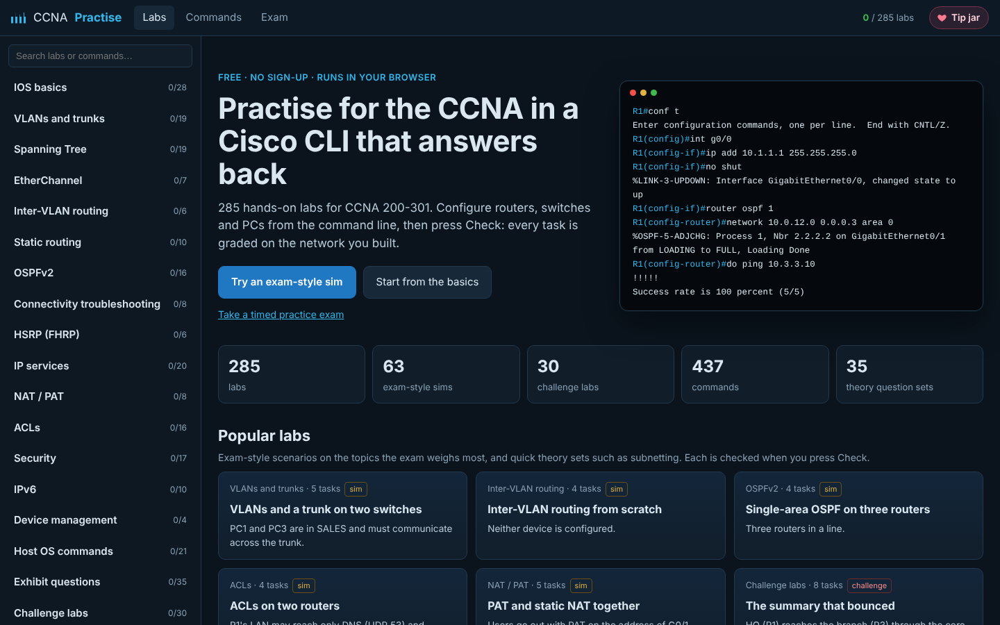
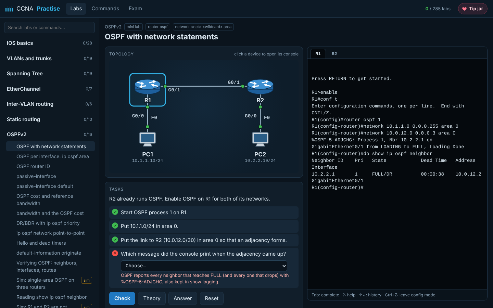
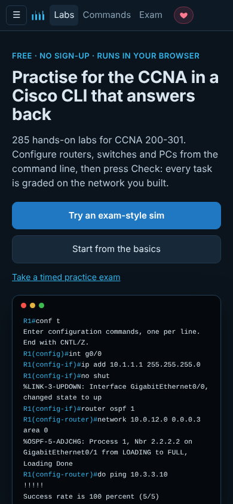

<div align="center">

# CCNA Practise

**Free CCNA 200-301 labs with a Cisco IOS command line, right in your browser.**

285 hands-on labs · 63 exam-style simulations · 30 challenge labs · 35 theory question sets · exam mode · no sign-up, no install

### [Open the labs →](https://arpwatcher.github.io/CCNA-Practise-/)

[](https://github.com/arpwatcher/CCNA-Practise-/actions/workflows/ci.yml)
[](LICENSE)
[](https://paypal.me/johnpas09)



</div>

## What it is

You get a network drawing, a list of tasks and a console for every device.
You type real IOS commands into routers and switches, and real Windows,
Linux or macOS commands into the PCs. Then you press **Check**. Each task is
graded on the network you built, not on the words you typed, so any correct
answer passes.



## Why use it

- **It feels like IOS.** You get user, privileged and config modes,
  abbreviations (`conf t`, `int g0/0`, `sh ip int br`), `?` help, Tab
  completion and history. `do`, `| include` and `| section` work, and errors
  come with the caret under the mistake.
- **There is a real network behind it.** OSPF forms adjacencies, elects a
  DR/BDR, runs SPF and prints `%OSPF-5-ADJCHG`. STP blocks ports, and
  EtherChannel bundles links. ACLs count their matches, NAT translates, and
  HSRP fails over. Ping and traceroute go hop by hop, and you get `.!!!!`,
  `U.U.U`, "Destination host unreachable" or, in a routing loop, "TTL
  expired in transit" wherever the real network would give them.
- **Made for phones too.** On a touch screen the console gets the keys a
  phone keyboard lacks: Tab, `?`, the history arrows, Ctrl+Z and Ctrl+C.
- **The PCs have real terminals.** `ipconfig /all`, `ip addr`, `ifconfig`,
  `nslookup`, `dig`, `ping`, `tracert` and `traceroute` all work, each in the
  OS's own output format.
- **Exam mode.** Random simulations on a timer, with no hints and no going
  back, scored out of 1000 like the real exam. Challenge labs go further:
  bigger topologies, several topics in one lab, and faults to find.
- **Nothing to install.** It runs in any browser, phone included. Your
  progress and the work in each lab stay in your browser, and you can export
  them to a file.

<p align="center"></p>

## What is covered

| Module | Topics | Labs |
| --- | --- | ---: |
| IOS basics | modes, hostname, passwords, interfaces, saving | 28 |
| VLANs and trunks | VLANs, access, voice, trunk, native, DTP, MAC learning | 19 |
| Spanning Tree | Rapid PVST+, root bridge, PortFast, BPDU Guard | 19 |
| EtherChannel | LACP, PAgP, static, L3 EtherChannel | 7 |
| Inter-VLAN routing | router on a stick, SVIs, routed ports | 6 |
| Static routing | next hop, default, floating, host, summary, Null0 | 10 |
| OSPFv2 | network, router-id, passive, cost, DR/BDR, timers | 16 |
| Connectivity troubleshooting | ping, extended ping, traceroute, debug, routing loops | 8 |
| HSRP (FHRP) | virtual gateway, priority, preempt, version 2 | 6 |
| IP services | DHCP, relay, NTP, syslog, SNMP, CDP, LLDP | 20 |
| NAT / PAT | static, dynamic, overload, port forwarding | 8 |
| ACLs | standard, extended, named, wildcards, vty, sequence | 16 |
| Security | SSH, AAA with TACACS+/RADIUS, port security, DHCP snooping, DAI | 17 |
| IPv6 | addressing, EUI-64, link-local, SLAAC, static routes | 10 |
| Device management | IOS image, boot system, config-register, TFTP | 4 |
| Host OS commands | Windows, Linux and macOS: ipconfig, ip addr, ifconfig, ARP, DNS | 21 |
| Exhibit questions | subnetting (VLSM and drills), IPv6 subnetting and address types, private ranges and APIPA, ports and TCP/UDP, DHCP, DNS, SNMP and NTP, syslog, FHRP, 802.1X, WPA/WPA2/WPA3, WLAN creation in the WLC GUI, AP modes, 2.4 GHz channels, threats, VPNs, WAN links, cloud, cabling, architectures, virtualization, SD-Access, REST, JSON, Ansible and other config tools, QoS | 35 |
| Challenge labs | bigger topologies, several topics, faults and questions | 30 |
| Legacy (not on 200-301) | RIP, EIGRP, VTP | 5 |

Labs marked **sim** are short scenarios like the exam simulations. The
others teach one command each. The **Commands** page lists every command and
the labs that use it.

## Support the project

Every lab is free and stays free. There are no ads and no account. If the
labs helped you study (or pass), a tip pays for the time that goes into new
labs and fixes.

**[Leave a tip with PayPal](https://paypal.me/johnpas09)**. There is also a tip jar
button at the top of every page.

You can help in other ways too: star the repo, open an issue when an IOS
output looks wrong, or share it with someone studying for the CCNA.

## Run it yourself

It is a static page with no build step:

```sh
git clone https://github.com/arpwatcher/CCNA-Practise-.git
cd CCNA-Practise-
npm run serve        # then open http://localhost:8080
```

Tests:

```sh
npm ci
npm test             # replays every lab's model answer against the engine
npx playwright install chromium
npm run smoke        # types the answers into the page in a real browser
```

## How it is built

- `engine/` is the IOS simulation:
  - the command grammar and parser;
  - the device state;
  - `show` output;
  - the network: links, VLANs, STP, OSPF, ACLs, NAT, ARP, ping and traceroute;
  - the PC terminals.
- `labs/` holds the labs as plain data. Each lab has devices, links, tasks
  (each with a check that reads the device state) and a model answer.
- `app.js`, `topo.js` and `style.css` are the page.
- `tests/ccna-labs.test.js` replays every model answer. It fails if any
  task is left unpassed, if a task passes before anything is typed, or if a
  ping in the answer fails.

Contributions are welcome. A new lab is one object in `labs/<module>.js`.

## Disclaimer

CCNA Practise is an independent study tool. It is not affiliated with,
sponsored by or endorsed by Cisco Systems, Inc. Cisco, Cisco IOS and CCNA are
trademarks of Cisco Systems, Inc. The console is a simulation written from
scratch. It is not Cisco software, and it contains no real exam questions.

[MIT licence](LICENSE)
